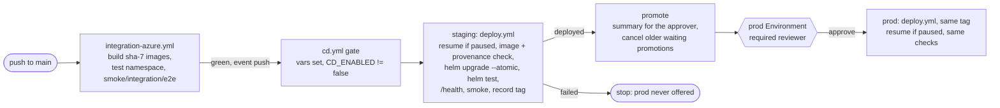

# Continuous deployment

Every green `integration-azure.yml` run for a push to `main` deploys that commit's `sha-<7>`
images to **staging**. When staging passes, the same tag waits for a reviewer and then goes to
**prod**. The workflow is [`cd.yml`](../../.github/workflows/cd.yml); the deploy itself is
[`deploy.yml`](../../.github/workflows/deploy.yml), called with `workflow_call`, so CD and manual
deploys run the same steps. Decided in [ADR 0002 §9](../adr/0002-aks-everywhere-and-azure-dns.md).

## When it runs

- **Trigger:** `workflow_run` on **Integration (Azure)**, `types: [completed]`, `branches: [main]`.
- **Gate** (job `gate`; every other job needs it):
  - the run concluded `success`, its event was `push`, its branch `main`, and it came from this
    repository;
  - the repo variables `AZURE_SUBSCRIPTION_ID`, `ACR_NAME`, `AZURE_LOCATION`,
    `AZURE_LOCATION_ABBR` are set, so CD skips green before bootstrap, like the other Azure
    workflows;
  - the repo variable `CD_ENABLED` is not `false`.
- **Schedule and dispatch runs of integration-azure don't deploy.** They also push `sha-<7>`
  images, but of a main head that a push run already built and deployed. Letting them through
  would redeploy the same tag and ask the prod reviewer again every night.
- **Retrying:** if a push run failed (flaky test), use **Re-run failed jobs** on it. The re-run keeps
  `event=push`, so CD starts once it's green. Re-running a green integration run, or re-running a CD
  run, deploys the same tag again.
- `workflow_run` always runs `cd.yml` (and the `deploy.yml` it calls) **from the default branch**,
  with a token for `main`, so the main-only `staging` and `prod` Environments accept it. The chart,
  tfvars and scripts come from the tested commit: `deploy.yml` checks out `ref` = the run's
  `head_sha` and refuses one that isn't on `main`.

## What gets deployed

- The tag is `sha-<first 7 of head_sha>`, the tag integration-azure pushed. Before touching a
  cluster, `deploy.yml` checks that every image the chart renders exists in ACR and that the api
  and web images' `org.opencontainers.image.revision` is on `main`
  ([image provenance](env-lifecycle.md#image-provenance)).
- **Prod only ever gets a tag that passed staging.** The `prod` job takes `image_tag` from the
  staging job's output. It runs only if `promote` ran, and `promote` runs only if staging reported
  `deployed` for exactly that tag.
- Post-deploy checks, in both envs: `helm upgrade --atomic --wait`, `helm test`, the `/health`
  check through the ingress, the smoke suite (create+read on staging, read-only on prod), then the
  `bbm-last-deployed-tag` / `deployed-at` tags on the data RG.
- CI's integration tests run the **arm64** images on the test cluster, while staging and prod run
  **amd64**, so an amd64-only regression first shows up in the staging smoke checks.

## Approving prod

1. Open the CD run. The **Promote to prod** summary shows the tag, the commit and the staging URL.
2. Click **Review deployments**, tick **prod**, then **Approve and deploy** (or **Reject**).
3. The prod job then resumes prod if it's paused, deploys and runs the checks. The run summary
   ends with a table of tag, env, URL and `/health` result per env.

The required reviewer comes from bootstrap's `gh_setup_commands` (`github_reviewer_ids`). If that
list was empty, add the reviewer by hand under **Settings → Environments → prod → Required
reviewers**, or prod deploys without approval.

An unanswered approval isn't a problem: the next green main build cancels the older CD run while
it's still waiting (see Concurrency), and GitHub fails a job that has waited 30 days for approval.

## Paused or down envs

`cd.yml` calls `deploy.yml` with `resume_if_paused: true`:

| state of the target env                                  | what CD does                                                                      |
| -------------------------------------------------------- | --------------------------------------------------------------------------------- |
| running                                                  | deploys                                                                           |
| `power-state=paused` (or AKS stopped / Postgres stopped) | runs `env-power.sh <env> resume` (Postgres start, `az aks start`), then deploys   |
| `power-state=down`, or no cluster                        | **fails**: "run env-power `<env>` up". Then re-run the CD run (or deploy by hand) |

- The env stays **running** afterwards. The nightly auto-pause (06:00 UTC) pauses it again unless
  its data RG has `auto-pause=false`.
- Prod's resume happens **after** the approval, inside the gated job, so nobody starts prod
  without a reviewer. It runs as `gh-bbm-prod`, whose Contributor role on the prod data and compute
  RGs covers AKS/Postgres start and the RG tags (staging likewise as `gh-bbm-staging`).
- A resume adds about 5–15 minutes to the run. A main merge while staging is paused therefore turns
  staging back on until the next night.
- Manual `deploy.yml` runs keep the old default (`resume_if_paused` off): a paused env is skipped
  green. Tick `resume_if_paused` to resume first.

## Concurrency

- `deploy.yml`'s job uses the concurrency group `env-<env>` with `cancel-in-progress: false`. The
  group is shared with `env-power.yml`'s manual jobs and manual deploys, so CD never races a pause,
  resume, `up`/`down` or another deploy, and **a running deploy is never cancelled** (a cancelled
  `helm upgrade` leaves a pending release).
- GitHub keeps one pending job per group. A newer queued staging deploy replaces an older queued
  one, and the older CD run then never promotes.
- A prod job waiting on the reviewer holds `env-prod`, so a newer run's prod job would only queue
  behind the stale one. Instead, after a successful staging deploy, `promote` cancels older CD
  runs whose status is still `waiting`, which here can only mean the prod approval (staging has no
  reviewer). An approved promotion is `in_progress` and is left alone; the newer one queues behind
  it. `gh run cancel` would also cancel an `in_progress` run, so `promote` re-reads each run's
  status just before cancelling it and skips any that is no longer `waiting`. A tiny race remains:
  an approval in the same second as that re-read can still be cancelled (re-run that CD run).
- While it waits, that prod job also holds `env-prod`, so manual `env-power prod` actions and manual
  prod deploys queue behind it until it is approved or rejected (or superseded by a newer run).
- There's no workflow-level group in `cd.yml`. `cancel-in-progress` there would also cancel
  running deploys.
- The scheduled auto-pause uses `env-power-scheduled-<env>`, not `env-<env>`, so an unanswered
  prod approval can't block it ([env-lifecycle.md](env-lifecycle.md#approvals)). Instead, for
  staging and prod it first waits (up to 30 minutes) for `in_progress` or `queued` runs of `cd.yml`
  and `deploy.yml`, so it doesn't stop a cluster mid `helm upgrade`. Runs `waiting` for the prod
  approval don't count. If deploys are still running after 30 minutes, that night's pause is
  skipped with a notice (the next schedule retries).

## Failures

- **Staging fails:** prod isn't offered. If `helm upgrade --atomic` timed out (pods not ready in
  10 minutes), Helm has already rolled the release back. If a later check failed (`helm test`,
  `/health`, smoke), the new release **stays** on staging and the run is red: fix forward with a new
  commit, or roll back (below).
- **Prod fails:** the same rules apply. Prod was approved for this tag, so roll back right away if a
  post-deploy check failed.
- **Env down:** fails with "run env-power `<env>` up". `up` redeploys the last deployed tag.

## Rolling back

Rollback is manual. Run **Deploy (AKS)** (`deploy.yml`) from `main` with `env=<env>` and
`image_tag=<older sha-7>` (prod needs the reviewer). The previous good tag is in the previous
deploy's run summary, or in `helm history bbm -n bbm` (the `global.image.tag` of an earlier
revision). A manual deploy uses the chart on `main` with the older images. If the chart changed
incompatibly since then, use `helm rollback bbm <revision> -n bbm` from an admin shell instead,
then run a manual deploy of a fixed tag. Re-running an older green CD run also redeploys its tag
(and its chart) through staging and the prod gate.

## Pausing CD

- **Repo variable (preferred):** `gh variable set CD_ENABLED --body false`. Every new CD run's gate
  then skips green. `gh variable delete CD_ENABLED` (or set `true`) turns it back on.
- **Disable the workflow:** `gh workflow disable cd.yml` (Actions → CD → ⋯ → Disable workflow).
- **One prod promotion:** reject it, or cancel the waiting run.
- A run that already started isn't affected by either switch; cancel it while it's queued or
  waiting, never during a `helm upgrade`.
