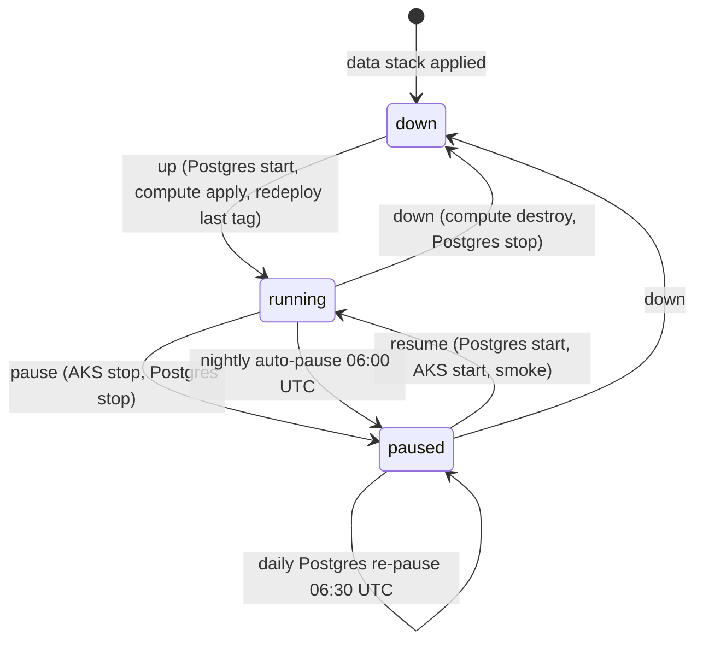

# Environment lifecycle: turning environments on and off

There are three AKS environments, each on its own cluster in its own region (ADR 0002 §8), on one
`Standard_B4as_v2` node:

| Env       | Region           | Cluster               | Runs                                                                 |
| --------- | ---------------- | --------------------- | -------------------------------------------------------------------- |
| `test`    | `northcentralus` | `aks-bbm-test-ncus`   | CI-run and PR-preview namespaces (see [The test env](#the-test-env)) |
| `staging` | `francecentral`  | `aks-bbm-staging-frc` | one release in namespace `bbm`                                       |
| `prod`    | `canadacentral`  | `aks-bbm-prod-cac`    | one release in namespace `bbm`                                       |

Below, `<abbr>` is the env's region code (`ncus`, `frc`, `cac`).
`infra/terraform/scripts/env-region.sh <env>` prints the env's region and its `DATA_RG`,
`COMPUTE_RG` and `CLUSTER` names from `envs/<env>/data.tfvars`.

They only need to be up for testing, development and demos, so all three can be switched off on
demand without losing data. The design is in [ADR 0001](../adr/0001-azure-environment-topology.md)
(power states) and [ADR 0002](../adr/0002-aks-everywhere-and-azure-dns.md) (the test env). This
page is the runbook. To create or delete environments, see
[azure-bootstrap.md](azure-bootstrap.md) (`infra/up.sh`, `infra/down.sh`).

Everything goes through one workflow, **Env power** (`.github/workflows/env-power.yml`). Its logic
lives in `infra/terraform/scripts/env-power.sh`, which you can also run locally after `az login`.

**Continuous deployment** ([cd.md](cd.md)) also turns envs on. A green `main` build resumes a
**paused** staging (and, after the reviewer approves, a paused prod) with the same
`env-power.sh <env> resume`, deploys, and leaves the env running until the nightly auto-pause. A
**down** env fails the CD run with "run env-power `<env>` up".

## States



The current state is stored as tags on the data resource group `rg-bbm-<env>-data-<abbr>`.
Terraform ignores these tags: the bootstrap stack's `lifecycle.ignore_changes` lists exactly
`power-state`, `auto-pause`, `db-paused`, `bbm-last-deployed-tag`, `paused-at`, `resumed-at`,
`down-at`, `up-at` and `deployed-at`.

| tag                                                          | values                      | written by                                              |
| ------------------------------------------------------------ | --------------------------- | ------------------------------------------------------- |
| `power-state`                                                | `running`, `paused`, `down` | env-power (`pause`, `resume`, `down`, `up`)             |
| `auto-pause`                                                 | `true` (default), `false`   | you (opt out of the nightly pause)                      |
| `db-paused`                                                  | `true`, `false`             | env-power (`false` when paused with `include_db=false`) |
| `bbm-last-deployed-tag`                                      | `sha-<7>`                   | `deploy.yml` after a successful deploy                  |
| `paused-at`, `resumed-at`, `down-at`, `up-at`, `deployed-at` | UTC timestamps              | env-power / deploy                                      |

`status` reads the real Azure state (AKS power and provisioning state, node pools, Postgres
state), these tags, the app host (`<env>.<zone>`) and `GET /health`.

## Actions

| action   | what it does                                                                                                                                                 | keeps                                                                                         | removes / stops                                                                                                              | typical time                |
| -------- | ------------------------------------------------------------------------------------------------------------------------------------------------------------ | --------------------------------------------------------------------------------------------- | ---------------------------------------------------------------------------------------------------------------------------- | --------------------------- |
| `status` | read-only snapshot                                                                                                                                           | everything                                                                                    | nothing                                                                                                                      | < 1 min                     |
| `pause`  | `az aks stop`, then `az postgres flexible-server stop` (unless `include_db=false`)                                                                           | every resource, cluster config, the IP, all data                                              | node VMs, Postgres compute                                                                                                   | 2–5 min                     |
| `resume` | Postgres start (waits for Ready), `az aks start`, waits for `/health`, read-only smoke tests                                                                 | everything                                                                                    | nothing                                                                                                                      | 5–15 min                    |
| `down`   | `terraform destroy` of the **compute** stack, then Postgres stop. Needs `confirm=<env>`                                                                      | Postgres + data, Key Vault, storage, identities, static IP, DNS zones and records, ACR images | AKS cluster, node pools, node RG contents, workload-identity federated credentials, the platform (cert-manager, certificate) | 5–10 min                    |
| `up`     | Postgres start, `terraform apply` of compute, platform install (`deploy/platform/install.sh`), then `deploy.yml` with the last deployed tag (not for `test`) | n/a                                                                                           | n/a                                                                                                                          | 10–15 min + deploy (~5 min) |

The data stack is never touched by env-power. Your database, uploaded sources and secrets survive
every action. On `test` every Postgres step is a no-op: it has no Postgres server.

### What it costs

What each state still bills (see [cost.md](cost.md) for estimates):

| state     | still billed                                                                                                                                |
| --------- | ------------------------------------------------------------------------------------------------------------------------------------------- |
| `running` | the node (one B4as_v2 per env), Postgres B1ms compute (not test), prod's Standard-tier control plane, plus everything below |
| `paused`  | the Standard load balancer and its frontend IP, the static public IP, Postgres storage, managed disks, Key Vault, storage, logs             |
| `down`    | the static public IP, Postgres storage, Key Vault, storage, logs                                                                            |

The Standard load balancer bills at its full hourly rate while the cluster is stopped, so `paused`
is far from free.

Test and staging are on the AKS Free tier (no control-plane charge). Prod is on the Standard tier
(uptime SLA), which bills per cluster-hour while the cluster runs. Choose `pause` for "off until
tomorrow" and `down` for "off for a week or more".

## The test env

`test` is a normal `data` + `compute` env (VNet `10.10.0.0/16`, Free tier, `northcentralus`, one
`Standard_B4as_v2` system node) with no Postgres server. It has no app release of its own. Instead, CI runs and PR
previews each get a namespace on its cluster:

| Kind       | Namespace                | Host                                         | TTL                             | Created by              |
| ---------- | ------------------------ | -------------------------------------------- | ------------------------------- | ----------------------- |
| CI run     | `run-<run_id>-<attempt>` | `https://run-<run_id>-<attempt>.test.<zone>` | 6 h                             | `integration-azure.yml` |
| PR preview | `pr-<n>`                 | `https://pr-<n>.preview.<zone>`              | 168 h, re-stamped on every push | `preview.yml`           |

Both go through the reusable workflow `_ephemeral-env.yml`. CI runs use GitHub Environment `test`
(main only, identity `gh-bbm-ephemeral`, images `bbm/*:sha-<7>`); previews use `preview` (any PR
branch, identity `gh-bbm-preview`, images `bbm-preview/{api,web}:pr-<n>-sha-<7>`, web `-mocked`).
`gh-bbm-preview` can push only `bbm-preview/*` (an ABAC condition on its ACR role), so a PR cannot
overwrite the `bbm/*` images staging and prod deploy. Each namespace gets:

- labels `bbm.io/ephemeral=true` and `bbm.io/kind=test|preview`, and the annotation
  `bbm.io/expires-on=<RFC3339>`;
- release `bbm` with `values-test.yaml`, in-cluster Postgres
  (`<acr>/mirror/postgres:16-alpine`, `emptyDir`, a random password per namespace);
- the env's wildcard certificate, served by Gateway `bbm` (gatewayClass `approuting-istio`) in
  `bbm-platform`, so no per-namespace certificate is issued;
- the namespace label `bbm.io/gateway-access=true`, without which the Gateway does not accept the
  namespace's HTTPRoute (set it by hand for a manual `helm install`).

**Auto-resume.** Before deploying, `_ephemeral-env.yml` reads the `power-state` tag on
`rg-bbm-test-data-ncus`:

| Tag / cluster state           | What the workflow does                                          |
| ----------------------------- | --------------------------------------------------------------- |
| `running` and cluster Running | deploys                                                         |
| `paused` (or cluster stopped) | runs `env-power.sh test resume`, then deploys (~5–10 min extra) |
| `down` (or no cluster)        | fails: "Run env-power.yml with env=test action=up first"        |

**Platform.** CI runs (environment `test`, main only) run `deploy/platform/install.sh test` on every
deploy (idempotent), so a merged platform change reaches the test cluster as `deploy.yml` brings
it to staging/prod. Previews never install or upgrade the cluster-wide platform: when `bbm-platform`
is missing, or the `bbm.io/platform-rev` annotation `install.sh` stamps on namespace `bbm-platform`
differs from `deploy/platform/install.sh --print-rev` of the PR's checkout, the preview fails with
"platform missing / outdated" (so a PR that changes the platform can't be previewed until merged). Fix it by letting a main run of `integration-azure.yml` finish
(or run `env-power.yml` env=test action=up), then re-run the preview.

Concurrent runs are safe: `resume` waits for a start already in flight, and for a stop in flight to
finish before it starts the cluster again.

The nightly auto-pause (06:00 UTC) pauses `test` too, so the nightly `integration-azure.yml` run
(07:00 UTC) and the first run of the day wait for the resume. Before pausing `test`, the job waits
up to 30 minutes for in-flight (queued, waiting or running) `integration-azure.yml` / `preview.yml`
runs; if some are still busy, `test` stays up until the next schedule.

**Teardown.** `integration-azure.yml` deletes its namespace at the end of the run (unless
dispatched with `keep_env`), and `preview.yml` deletes `pr-<n>` when the PR closes. A delete on a
stopped cluster is skipped green; the namespace is left for the janitor.

**Janitor.** `infra-janitor.yml` runs `infra/terraform/scripts/janitor.sh --apply` every 6 hours.
It deletes namespaces labelled `bbm.io/ephemeral=true` whose `bbm.io/expires-on` is in the past,
and only ones named `run-<id>-<attempt>` or `pr-<n>`. It exits cleanly while the test cluster is
paused or down, and catches up after the next resume. Weekly (Sunday 03:30 UTC) it also purges old
`bbm/*:pr-*` / `bbm/*:sha-*` and `bbm-preview/*:pr-*` images from ACR (that job waits for
`infra-global` approval). Run it locally with
`infra/terraform/scripts/janitor.sh --dry-run`.

To see what runs on the test cluster:

```sh
az aks get-credentials -g rg-bbm-test-compute-ncus -n aks-bbm-test-ncus --overwrite-existing
kubelogin convert-kubeconfig -l azurecli
kubectl get ns -l bbm.io/ephemeral=true \
  -o custom-columns='NAME:.metadata.name,KIND:.metadata.labels.bbm\.io/kind,EXPIRES:.metadata.annotations.bbm\.io/expires-on'
```

## Approvals

| action                      | test                             | staging                         | prod                                                 |
| --------------------------- | -------------------------------- | ------------------------------- | ---------------------------------------------------- |
| `status`                    | none (plan identity, read-only)  | none (plan identity, read-only) | none (plan identity, read-only)                      |
| `pause`                     | none (`test-infra`)              | none (`staging`)                | none: `prod-power` environment, power-only identity  |
| `resume`                    | none (`test-infra`)              | none (`staging`)                | 1 reviewer (`prod`)                                  |
| `down`                      | none (`test-infra`), `confirm`   | none (`staging`), `confirm`     | 1 reviewer (`prod`), `confirm=prod`                  |
| `up`                        | none (`test-infra`), no redeploy | none (`staging`)                | 1 reviewer for `up`, then again for the redeploy job |
| scheduled pause             | none (`test-infra`)              | none (`staging`)                | none (`prod-power`)                                  |
| scheduled Postgres re-pause | n/a (no Postgres server)         | none (`staging`)                | none (`prod-power`)                                  |

`test-infra` uses the `gh-bbm-test` identity (the same role set as `gh-bbm-staging`, on the test
RGs). CI runs and previews also resume the test cluster on their own, as `gh-bbm-ephemeral` and
`gh-bbm-preview`; see
[The test env](#the-test-env).

Anyone with workflow access can turn prod **off**. Turning it **on**, or changing it, needs a
reviewer. Manual prod `pause` running in `prod-power` without a reviewer is a deliberate choice:
pausing only reduces cost and exposure, keeps all data, and is reversed by a (reviewed) `resume`. `gh-bbm-prod-power` can only read, start and stop AKS and Postgres and write tags. It has
no Terraform state access and no Contributor role.

All environments used here only accept runs from `main` (`preview`, used only by `preview.yml`, is
the one environment open to PR branches). `status` uses the plan identity, which is federated for
`ref:refs/heads/main`, so dispatch it from `main` too.

`deploy.yml` and every manual mutating env-power job share the concurrency group `env-<env>`. A
deploy waits for a pause or resume to finish and the other way round. GitHub keeps at most one
pending run per group, so a newer queued run replaces an older queued one. CD (`cd.yml`) deploys
through `deploy.yml`, so it uses the same groups; a CD prod promotion still waiting for approval is
cancelled by the next green build instead (see [cd.md](cd.md#concurrency)).

The scheduled jobs (`scheduled-pause`, `scheduled-repause-db`) use their own group,
`env-power-scheduled-<env>`. A prod run waiting on an unanswered `prod` approval holds `env-prod`,
and would otherwise block the nightly pause indefinitely. Running outside `env-<env>` is safe for
Terraform: `env-power.sh` refuses to stop a cluster whose `provisioningState` is not `Succeeded`,
so it never stops one in the middle of an `up`/`down` apply.

### Image provenance

`deploy.yml` deploys only images built from `main`. Every image pushed by `_build-push.yml` carries
the OCI labels `org.opencontainers.image.source` and `org.opencontainers.image.revision` (the
commit SHA). Before touching the cluster, the deploy reads the revision label of the api and web
images and fails unless that commit is an ancestor of `origin/main`. `integration-azure.yml`,
which pushes the `sha-<7>` images that staging and prod deploy, also runs only from `main`.

Only main-only identities can write `bbm/*`: `gh-bbm-ephemeral` (GitHub Environment `test`, main
only) and the build identities in `acr_push_principal_ids`. PR previews push as `gh-bbm-preview`,
whose Container Registry Repository Writer assignment is ABAC-conditioned to `bbm-preview/*`
(registry in ABAC repository-permissions mode, see ADR 0002 §4), so a workflow edited in a PR can
no longer overwrite a `sha-*` tag. The revision-label check stays as a second guard.

## Schedules

All times are UTC and run from the default branch.

| cron         | job                    | what it does                                                                                                                                 |
| ------------ | ---------------------- | -------------------------------------------------------------------------------------------------------------------------------------------- |
| `0 6 * * *`  | `scheduled-pause`      | pauses every env (test included) whose cluster is running, unless its data RG has `auto-pause=false`; test waits for in-flight CI/previews  |
| `30 6 * * *` | `scheduled-repause-db` | Azure auto-starts a stopped Postgres after 7 days. If the env is `paused`/`down` and Postgres is Ready, stop it again. Staging and prod only |
| `0 11 * * 0` | `scheduled-pause`      | Sunday retry: the AKS maintenance window (Sun 06:00–10:00) can block the 06:00 stop                                                          |

### Opting out of the nightly pause

For a multi-day demo or a long load test:

```sh
az group update -n rg-bbm-<env>-data-<abbr> --set tags.auto-pause=false
# and afterwards
az group update -n rg-bbm-<env>-data-<abbr> --set tags.auto-pause=true
```

Remember to turn it back on. An opted-out environment runs (and bills) until someone pauses it.

## Demo-day checklist

1. **The day before:** run **Env power** with `action=resume` (paused) or `action=up` (down). For
   prod, a reviewer must approve.
2. If the demo spans 06:00 UTC, set `auto-pause=false` (see above).
3. Run `action=status`. Check: AKS `Running`/`Succeeded`, Postgres `Ready`, `/health` `ok`.
4. Check the smoke result in the resume/deploy run summary. To redeploy a specific build, run
   **Deploy (AKS)** with `image_tag=sha-<7>`.
5. Share the URL: `https://<env>.<zone>` (for example `https://prod.bbm.example.com`). The
   wildcard certificate comes from the platform layer; check it with
   `kubectl get certificate -n bbm-platform bbm-wildcard`.
6. **After the demo:** run `action=pause` and set `auto-pause=true` again if you changed it.

## Running it locally

```sh
az login --use-device-code
infra/terraform/scripts/env-power.sh test status
infra/terraform/scripts/env-power.sh staging status
infra/terraform/scripts/env-power.sh staging pause --include-db true
infra/terraform/scripts/env-power.sh staging resume
```

`down` and `up` need Terraform and state access, so run them through the workflow.

## Limitations

- **Load balancer and public IP are billed while paused.** The static IP lives in the data RG on
  purpose, so it and the DNS records that alias it survive `down`.
- **Postgres auto-starts after 7 days stopped.** The 06:30 job stops it again. Between the
  auto-start and that job you pay for up to a day of Postgres compute.
- **A stop is refused unless `provisioningState` is `Succeeded`.** Upgrades and node image updates
  run in the Sunday 06:00–10:00 UTC maintenance window. A scheduled pause that hits it exits with a
  warning, and the 11:00 Sunday run retries. A manual pause exits with code 3; retry later.
- **A cluster can stay stopped for at most 12 months.** After that AKS may no longer start it.
  Auto-upgrades also only happen while the cluster runs, so a long-paused cluster falls behind on
  patches. Prefer `down`/`up` for long breaks: `up` creates a fresh cluster on the current patch.
- **`up` gives the cluster a new OIDC issuer.** The compute stack recreates the federated
  credentials, so a full `up` must finish before you deploy. The workflow's `redeploy` job does that.
- **`down` is refused without `confirm=<env>`**, and the run still needs the prod reviewer for prod.

## Troubleshooting

| symptom                                                       | cause / fix                                                                                                                                                                                                                                      |
| ------------------------------------------------------------- | ------------------------------------------------------------------------------------------------------------------------------------------------------------------------------------------------------------------------------------------------ |
| Deploy run is green but says "skipped: env is paused/down"    | Expected for manual deploys. Run `resume` (or `up`) and deploy again, or set `resume_if_paused`. CD resumes on its own. `up` redeploys automatically.                                                                                            |
| `refusing to stop ...: provisioningState is 'Upgrading'`      | Maintenance or another operation is running. Wait: `az aks show -g rg-bbm-<env>-compute-<abbr> -n aks-bbm-<env>-<abbr> --query provisioningState`.                                                                                                   |
| `cluster ... not found: <env> is down`                        | The compute stack was destroyed. Use `up`, not `resume`.                                                                                                                                                                                         |
| Resume finished but `/health` never answers                   | Pods are still starting or crash-looping. `kubectl -n bbm get pods`, `kubectl -n bbm describe pod ...`. Check Postgres is `Ready`. A failing Key Vault CSI mount usually means a broken federated credential: run `up`, which reapplies compute. |
| `Postgres ... is 'Updating'; cannot stop it now`              | Azure maintenance on the server. Retry later.                                                                                                                                                                                                    |
| Deploy: `No image_tag given and ... no bbm-last-deployed-tag` | First deploy to this env. Pass `image_tag=sha-<7>` (an image built by CI on `main`).                                                                                                                                                             |
| Deploy: `missing image <acr>/bbm/api:sha-...`                 | That tag was never pushed, or the janitor purged it. Build it or pick another tag. Also `mirror/curl:8.10.1` must be imported once per ACR (see `deploy/helm/README.md`).                                                                        |
| A scheduled run fails with an OIDC / `AADSTS700213` error     | The GitHub Environment (`test-infra` / `staging` / `prod-power`) or its `AZURE_CLIENT_ID` variable is missing. Re-run the bootstrap `gh_setup_commands`.                                                                                         |
| CI run fails: "The test env is down"                          | The test compute stack is destroyed. Run **Env power** with `env=test action=up`, then re-run the workflow.                                                                                                                                      |
| `up` fails waiting for the certificate                        | See the certificate rows in [azure-bootstrap.md troubleshooting](azure-bootstrap.md#troubleshooting). `kubectl describe certificate -n bbm-platform bbm-wildcard`.                                                                               |
| Tags look wrong (`power-state=running` but cluster stopped)   | Someone used the portal or CLI directly. Run `pause` or `resume` once; both are idempotent and rewrite the tags.                                                                                                                                 |
